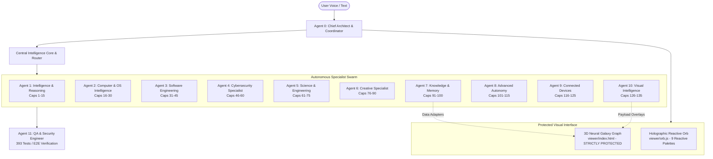

# J.A.R.V.I.S. Multi-Agent Swarm Architecture
**Project:** J.A.R.V.I.S. Autonomous Operating Intelligence  
**System Version:** 2.0.0 (Swarm Architecture Build)  
**Date:** 2026-11-12  
**Coordinator:** Agent 0 (Chief Architect & Lead Integration Coordinator)

---

## 1. Architectural Philosophy

Project J.A.R.V.I.S. is engineered around the principle:
> **One Intelligence. One Memory. One Orchestrator. Many Specialized Capabilities.**

Rather than operating as a disconnected collection of standalone scripts or mock chatbots, J.A.R.V.I.S. coordinates an integrated ecosystem of 11 specialized autonomous agents organized through Antigravity's native `/swarm` architecture.

---

## 2. Agent Roles and Domain Ownership

| Agent # | Role Name | Member Name | Capability Ownership | Core Subsystem Path | Primary Responsibilities |
| :---: | :--- | :--- | :---: | :--- | :--- |
| **0** | Chief Architect | `coordinator` | Global Orchestration | `jarvis/core/` | System stability, contract enforcement, global API dispatch, user communication. |
| **1** | Intelligence & Reasoning | `intelligence` | Caps 1–15 | `jarvis/intelligence/` | Deep multi-source research, hypothesis generation, evidence cross-referencing, predictive modeling. |
| **2** | Computer & OS Intelligence | `desktop` | Caps 16–30 | `jarvis/desktop/` | Full desktop vision, Win32 window management, virtual cursor, Bezier mouse motion, hardware telemetry. |
| **3** | Software Engineering | `software` | Caps 31–45 | `jarvis/software/` | AST syntax verification, automated test generation, repository code mapping, diff patch engine. |
| **4** | Cybersecurity Intelligence | `security` | Caps 46–60 | `jarvis/cybersecurity/` | Defensive posture analysis, SHA-256 FIM, firewall auditing, vulnerability management, authorized checks. |
| **5** | Science & Engineering | `science` | Caps 61–75 | `jarvis/science/` | Symbolic math, kinematics, RLC circuit simulation, CAD STL/DXF generators, FFT signal processing. |
| **6** | Creative Intelligence | `creative` | Caps 76–90 | `jarvis/creative/` | Film production call sheets, storyboards, audio LUFS analysis, animation timing, brand guidelines. |
| **7** | Knowledge & Memory | `knowledge` | Caps 91–100 | `jarvis/memory/` | Directed entity knowledge graph, semantic BM25/cosine search, timeline indexing, deduplication. |
| **8** | Advanced Autonomy | `autonomy` | Caps 101–115 | `jarvis/autonomy/` | DAG task planning, topological sorting, CircuitBreaker error recovery, background worker pools. |
| **9** | Connected Devices | `devices` | Caps 116–125 | `jarvis/devices/` | Local ARP network discovery, smart device adapters, MQTT broker, sensor dashboards, database probes. |
| **10** | Visual Intelligence | `visual` | Caps 126–135 | `jarvis/visual/` | Holographic HUD data payloads, timeline/statistical chart generators, screen annotations. |
| **11** | Quality Assurance | `qa` | All 135 + E2E | `tests/` | Cross-agent integration testing, regression tests, capability registry generation. |
| **—** | Stall Monitor | `monitor` | Board Health | `.system_generated/` | Watches message board cadence and breaks stalls autonomously. |

---

## 3. Strict Invariant: Protected 3D Knowledge Graph

As mandated by system requirements, the existing 3D Neural Galaxy Graph visualization is treated as an immutable, protected component:
1. `viewer/index.html` and `viewer/orb.js` visual layout, colors, Three.js force graph, and shaders remain 100% intact.
2. All agents interact with the knowledge graph strictly through backend data adapters (`jarvis/knowledge/graph_adapter.py` and `jarvis/visual/graph_adapter.py`).
3. Agents generate data payloads, node metadata updates, and HUD overlay arrays without touching the frontend Three.js rendering code.

---

## 4. Swarm Message Board Communication Protocol

All agents collaborate through the shared Antigravity Swarm message board:
- `@coordinator`: Used by specialists to report completed milestones, deliverables, and test metrics.
- `@qa`: Invoked to independently execute verification test suites and record official statuses.
- Peer-to-peer handoffs: Workers tag specific peers when passing intermediate schemas or data artifacts.
- No polling: Agents sleep on the board using `swarm_wait` at zero token cost until an `@mention` wakes them.
